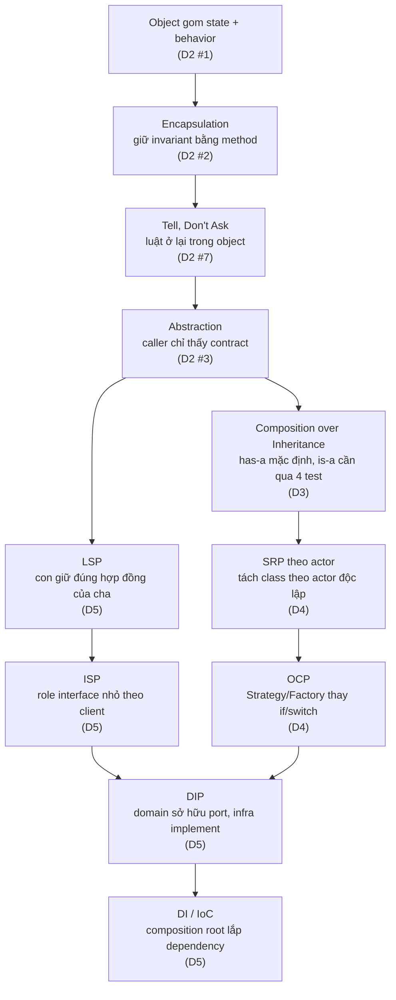

# Capstone · 01 Tổng kết OOP + SOLID

## Bảng tổng kết (từ Khung nhớ nhanh D2–D5)

| Nguyên lý | Câu hỏi kiểm tra | Dấu hiệu vi phạm | Công cụ sửa |
|---|---|---|---|
| **Encapsulation / invariant** | Ai được chạm vào dữ liệu? Luật này do ai giữ? | `set_x()` hoặc field bị ghi trực tiếp từ ngoài; invariant có thể bị phá qua đường vòng | Method kiểm soát thay đổi, field `_private`, không getter/setter "ngu" |
| **Tell, Don't Ask** | Code gọi có đang đọc state rồi tự quyết định thay vì nhờ object làm? | `if obj.status == X: obj.y = Z` lặp ở nhiều nơi gọi | Đẩy quyết định + luật vào method của chính object giữ state đó |
| **Composition over Inheritance** | Quan hệ là is-a (qua đủ 4 phép thử) hay chỉ muốn dùng lại code? | `class A(B)` chỉ để tái dùng method, không thật sự là B; cây kế thừa sâu | Tách phần đổi → đặt contract → giữ + uỷ quyền (constructor injection) |
| **SRP theo actor** | Ai là actor sẽ yêu cầu sửa đoạn code này, vì lý do riêng của họ? | ≥2 actor độc lập (vd kế toán vs kho vs hạ tầng) cùng sửa 1 class/file | Tách theo actor thành nhiều class, mỗi class một lý do thay đổi |
| **OCP + Strategy/Factory + composition root** | Thêm biến thể mới có phải mở lại, sửa code cũ đã test không? | `if/switch` theo loại, mỗi loại mới phải sửa thêm nhánh ở nhiều nơi | Interface + nhiều implementation (Strategy), Factory chọn implementation, lắp ở composition root (`*.module.ts`) |
| **LSP + hợp đồng** | Thay cha bằng con, caller còn đúng mà không cần biết kiểu thật? | Con đòi nhiều hơn (precondition chặt hơn), hứa ít hơn (postcondition yếu hơn), ném lỗi mới, phá bất biến cha; caller phải `isinstance` | Viết rõ hợp đồng (nhận gì/trả gì/lỗi gì), test chung chạy cho mọi implementation, composition thay kế thừa |
| **ISP + role interface** | Client này gọi những method nào trong interface nó nhận? | Implementation phải stub `throw new Error('not supported')`; interface to, test phải mock cả interface dù chỉ dùng 1 method | Bảng client × method, tách role interface nhỏ theo nhu cầu của client (không theo implementation) |
| **DIP + ai sở hữu interface** | File nghiệp vụ có nhắc tên công nghệ không? Port nằm trong package của ai, viết bằng từ vựng của ai? | Service import driver/ORM/SDK trực tiếp; chữ ký port có kiểu của thư viện hạ tầng (`ClientSession`, `Document`, mã lỗi Mongo) | Port (interface) do domain/application sở hữu, adapter nằm ở infrastructure, composition root nối hai bên |
| **DI / IoC** | Ai gọi constructor của dependency? Ai nắm luồng chạy? | `new MySQLOrderRepo()` ngay trong service nghiệp vụ (DI mà không DIP cũng tính là mùi nếu kiểu cụ thể rò vào domain) | Constructor injection; NestJS container làm IoC + DI qua token/`useClass`/`useExisting` |

**Lưu ý:** DIP, DI, IoC là ba khái niệm khác nhau — có thể có DI mà không có DIP (inject thẳng class cụ thể `OrderService(repo: MySQLOrderRepo)`), có thể có IoC mà không có DI (template method, route handler tự được framework gọi).

## Sơ đồ: các nguyên lý nối với nhau thế nào

**Đường đọc:** state+behavior → Encapsulation giữ luật → Tell-Don't-Ask là cách viết để luật không rò ra ngoài → Abstraction cho caller chỉ thấy hợp đồng → từ đây tách hai nhánh: (1) *cấu trúc nhiều implementation cho cùng 1 contract* đi qua Composition → SRP → OCP (Strategy/Factory); (2) *đúng đắn của việc thay thế* đi qua LSP → ISP → DIP → DI/IoC (ai sở hữu contract, ai lắp ráp).

---

[Mục lục](README.md) · [02 Chọn module](02-chon-module.md) →
