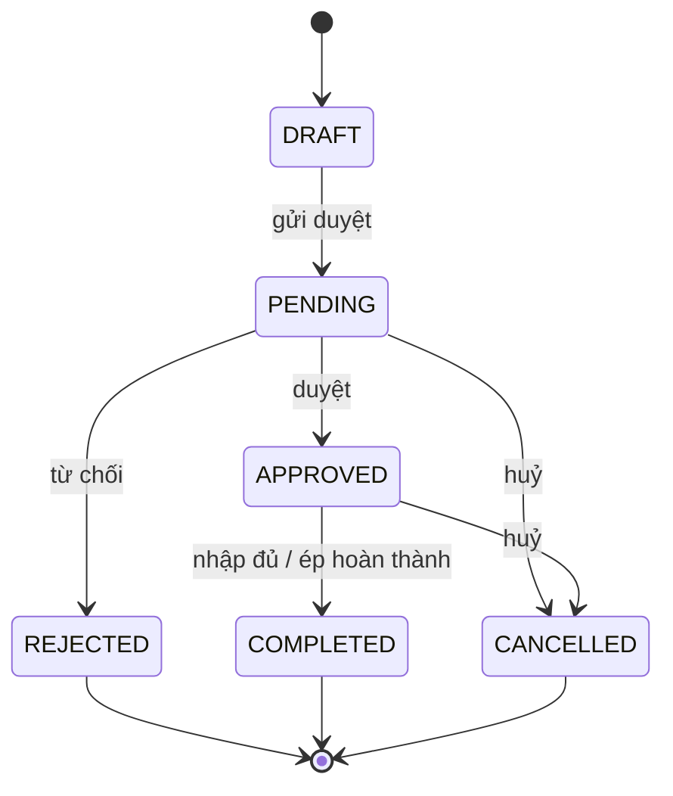

# Capstone · 03 Hiện trạng purchased-request

## Hiện trạng `purchased-request`

> Đọc kèm: thiết kế mới ở [06-thiet-ke-lai.md](06-thiet-ke-lai.md), cách đọc luồng request ở [05-hexagonal-trong-nestjs.md](05-hexagonal-trong-nestjs.md#4-luồng-một-request-đi-qua-nestjs).

> Viết tắt: `S` = `purchased-request.service.ts`, `C` = `purchased-request.controller.ts`, `P` = `processors/status-updater.processor.ts`, `M` = `purchased-request.module.ts`. Đường dẫn gốc: `erp/backend/src/modules/purchased-request/`.

### 3.1 Nghiệp vụ

YCMH (Yêu cầu mua hàng) là phiếu một bộ phận gửi lên để xin mua nguyên vật liệu (NVL). Mỗi phiếu có nhiều dòng item, mỗi item là một NVL kèm số lượng. Phòng mua hàng lập đơn mua (PO) dựa trên các phiếu đã duyệt. Khi kho nhập hàng đủ, item và phiếu tự hoàn thành.

**Vòng đời trạng thái** (`constants/status-transitions.ts:7-18`, áp cho cả phiếu và item):

**Các luồng chính:**

| # | Luồng | Các bước nghiệp vụ | Điểm vào |
|---|---|---|---|
| 1 | Lập / sửa YCMH | kiểm tra field bắt buộc theo nhà máy (LAB cần product type; mọi nhà máy trừ Bình Minh cần thời gian sử dụng) → sinh mã `YCMH-MMYYYY-NN` → lưu phiếu + item (kiểm tra chuyển trạng thái item) → tính lại trạng thái phiếu từ item → xuất Excel lên S3, lưu link → (tuỳ chọn) gửi email duyệt | `C:39`, `C:51` → `S:522` |
| 2 | Nhập YCMH từ Excel | đọc file + validate từng dòng → nếu lỗi: dựng file Excel đánh dấu lỗi, upload S3, trả link tạm 24h → nếu hợp lệ: nhóm theo mã phiếu, tạo phiếu DRAFT | `C:58` → `S:1816` |
| 3 | Gửi duyệt hàng loạt | kiểm tra phiếu tồn tại và đang DRAFT → bổ sung file Excel còn thiếu → gửi email kèm file → chuyển DRAFT → PENDING (cả item) | `C:137` → `S:1571` |
| 4 | Duyệt / từ chối / huỷ phiếu | kiểm tra chuyển trạng thái → đồng bộ trạng thái mọi item | `C:131` → `S:1532` |
| 5 | Huỷ 1 item | khoá → kiểm tra chuyển trạng thái → chặn nếu NVL đã nằm trong PO Confirmed/Completed → xoá dòng PO Draft/Pending liên quan → tự huỷ PO rỗng → phân bổ lại phí ship các PO bị ảnh hưởng → tính lại trạng thái phiếu | `C:111` → `S:1205` |
| 6 | Ép hoàn thành 1 item | khoá → chỉ item APPROVED → chặn nếu còn PO đang xử lý dở → COMPLETED → tính lại trạng thái phiếu | `C:121` → `S:1353` |
| 7 | Tra cứu | danh sách (`S:643`); chi tiết kèm SL đã nhập, SL trong PO, PO liên quan, SL chưa nhận, tồn kho hôm nay (`S:1023`); YCMH đã duyệt còn SL để lập PO + giá xác nhận gần nhất (`S:1088`) | `C:92-106` |
| 8 | Xuất Excel | 1 phiếu (`S:75`) hoặc toàn bộ theo bộ lọc (`S:94`) | `C:64`, `C:78` |
| 9 | Tự hoàn thành (bất đồng bộ) | nghe sự kiện `ImportConfirmed`, `PurchasedOrderCompleted` → item APPROVED có SL duyệt = SL trong PO = SL đã nhập thì COMPLETED → phiếu COMPLETED/CANCELLED khi hết item mở | `P:27-43`, `P:154` |
| 10 | Xoá phiếu | chỉ phiếu DRAFT | `C:45` → `S:704` |

### 3.2 Bản đồ trách nhiệm (actor → method)

| Actor | Lý do riêng để đổi code | Method đang gánh |
|---|---|---|
| **Bộ phận yêu cầu** (người lập YCMH) | form phiếu, field bắt buộc, cách đánh mã | `storage` `S:522`, `createFromFile` `S:1816`, `delete` `S:704`, `generateCode` `S:1551` |
| **Người duyệt** (quản lý) | quy trình duyệt, người nhận email, nội dung email | `changeStatus` `S:1532`, `sendBulkApprovalEmail` `S:1571`, `markRequestsAsPending` `S:1631`, `sendApprove` `S:1658` (chết), `PurchasedRequestApprovalMailService` |
| **Mua hàng** (lập PO) | khi nào được huỷ/đóng item, SL còn lại để đặt | `findWithPO` `S:1088`, `cancelItem` `S:1205`, `forceCompleteItem` `S:1353`, `getInProgressPurchaseOrders` `S:851`, `getLatestConfirmedUnitPrices` `S:879` |
| **Kế toán chi phí PO** | công thức phân bổ phí ship, VAT, làm tròn | phần phân bổ phí ship trong `cancelItem` `S:1268-1328`, `recalculatePOItemShippingCosts` `S:1414` (chết) |
| **Kho** | cách tính SL đã nhập, tồn kho, chưa nhận | `getRequestItemQuantities` `S:726`, `getUnreceivedQuantities` `S:920`, `getInventoryQuantities` `S:995`, processor `P:173-260` |
| **Báo cáo / người xuất file** | cột, tiêu đề, định dạng Excel | `exportToExcel*` `S:75-520`, `generateErrorExcelAndUpload` `S:1723` |
| **Vận hành đa nhà máy** (LAB, Bình Minh, Toàn Cầu, DFWUS) | luật riêng từng nhà máy | `S:525-552`, `S:1817-1827`, `S:1668-1676` |
| **Hạ tầng** | S3, file tạm, email, khoá, ORM | `S:131-150`, `S:105`, `S:1799-1810`, constructor `S:66-73` |

**Kết luận:** 8 actor trên một class 2060 dòng. Đây là god class theo đúng định nghĩa SRP của D4.

### 3.3 Sơ đồ phụ thuộc hiện tại (mũi tên = chiều import / gọi)

```mermaid
flowchart LR
  subgraph clients["Client ngoài module"]
    OP["order-plan/OrderPlanPurchaseService"]
    NA["nvl-alert/NvlAlertPurchaseService"]
  end
  C["PurchasedRequestController"] --> S["PurchasedRequestService (2060 dòng)"]
  OP -->|"storage(dto as never)"| S
  NA -->|"storage()"| S
  S --> AM["PurchasedRequestApprovalMailService"]
  S --> AGG["StatusAggregator + VALID_STATUS_TRANSITIONS"]
  S -->|"new"| FR["PurchasedRequestFileReader"]
  S --> FW["FileWriterFactory"]
  S --> XL["exceljs"]
  S --> FS["fs (file tạm)"]
  S --> S3["S3Service"]
  S --> I18N["I18nService"]
  S -.->|"inject, không dùng"| RB["RabbitService"]
  S -.->|"chỉ code chết dùng"| EM["Email (email-templates)"]
  S --> POU["purchased-order/utils + dto"]
  S --> DS["TypeORM DataSource"]
  AM --> EM
  AM --> DS
  FR --> DS
  DS --> T1[("purchased_request(_items)")]
  DS --> T2[("purchased_orders(_items) — của PO")]
  DS --> T3[("imports, import_details, daily_inventory_summary — của kho")]
  DS --> T4[("providers, materials, accounts, config")]
  EV(["Rabbit: ImportConfirmed, PurchasedOrderCompleted"]) --> P["PurchasedRequestStatusUpdater"]
  P --> DS
```

Mọi mũi tên đi từ nghiệp vụ ra hạ tầng: service biết tên bảng của module khác, biết `exceljs`, biết ACL của S3.

### 3.4 Bảng vi phạm

| Nguyên lý | Vị trí | Bằng chứng | Hậu quả |
|---|---|---|---|
| **SRP** | `S:63-2060`, ctor `S:66-73` | 8 actor (mục 3.2), 6 dependency hạ tầng | Sửa cột Excel và sửa luật huỷ PO cùng đụng một file; review và test khó khoanh vùng |
| **Encapsulation (ranh giới aggregate)** | `S:1239-1328` | YCMH tự xoá dòng PO (`S:1296`), tự huỷ PO (`S:1307`), tự phân bổ phí ship PO (`S:1320-1328`) | Luật của PO nằm ở module khác; PO đổi trạng thái mà không qua `PurchasedOrderService`, không phát sự kiện, không audit PO |
| **Encapsulation / Tell, Don't Ask** | entity `database/entities/purchased-request.entity.ts:14-51`; `S:1265`, `S:1392`, `S:1544-1545`, `S:1971-2038` | Entity chỉ có `@Column`, không có method; service tự gán `item.status` ở nhiều chỗ | Anemic model: luật trạng thái rải ra service, processor, file reader |
| **Một luật, nhiều bản** | `utils/status-aggregator.ts:22` và `P:252` ("Mirrors PurchasedRequestStatusAggregator"); `S:1921` và `S:1939` | Luật tổng hợp trạng thái viết 2 lần; 2 hàm validate chỉ khác message | Đổi luật ở một nơi, nơi kia lệch; bug âm thầm |
| **OCP** | `S:525-552`, `S:1817-1827`, `S:1668-1676` | `if (isLabApp)`, `if (!isBinhMinhApp)`, map tên nhà máy lặp ở 3 chỗ | Thêm nhà máy thứ 5 phải mở lại nhiều hàm đã test |
| **DIP (dữ liệu module khác)** | `S:740-741`, `S:756`, `S:805`, `S:891`, `S:1004`, `S:932-973` | Raw SQL / query builder trực tiếp vào bảng `import_details`, `imports`, `purchased_orders`, `providers`, `daily_inventory_summary` | Đổi schema kho/PO làm vỡ YCMH lúc chạy, compiler không báo |
| **DIP (hạ tầng)** | `S:41`, `S:48`, `S:140-145`, `S:159`, `S:1727-1810` | Import `typeorm`, `exceljs`, `fs`; tự đặt ACL, Content-Type, key S3 | Không test luật nghiệp vụ mà không dựng DB, S3, file system |
| **DIP (lỗi framework)** | `S:12`, `S:1252`, `S:1376`, `S:1928` | Ném `BadRequestException` của NestJS, dịch i18n ngay trong luật | Luật gắn với HTTP; processor (`P`) không phải HTTP vẫn phải nhận lỗi HTTP |
| **Hợp đồng (D5)** | `S:713-716` | Phiếu không phải DRAFT lại ném `NotFoundException` | Client nhận 404 cho lỗi "không được xoá", hiểu sai |
| **Hợp đồng (D5)** | `S:624-627`, `S:631-639` | Gửi mail fire-and-forget nhưng `.catch` lại `throw` (rejection không ai bắt); mọi lỗi khác bị gộp thành `SAVE_FAIL` | Postcondition mơ hồ: phiếu lưu xong nhưng mail có thể không đi; caller không phân biệt được lỗi |
| **ISP** | `M:30`, `order-plan/services/order-plan-purchase.service.ts:40`, `nvl-alert/services/nvl-alert-purchase.service.ts:57,103` | Export cả service; 2 client chỉ dùng `storage()` và phải ép kiểu `dto as never` | Client phụ thuộc 20+ method không dùng; hợp đồng là DTO HTTP, không phải lệnh nghiệp vụ |
| **Encapsulation (đồng thời)** | `S:1551-1569`; `order-plan-purchase.service.ts:32-33` | `generateCode` đọc mã cuối rồi +1, không khoá; client phải tự khoá | Invariant "mã duy nhất" không do chủ của nó giữ |
| **DI** | `S:1824` | `new PurchasedRequestFileReader(this.datasource, ...)`, reader tự query DB | Không thay reader khi test; DB rò sang tầng đọc file |
| **Code chết / dependency nói dối** | `S:1658-1721`, `S:1414-1530`, `S:71` + `S:1903-1913`, `S:67` | `sendApprove` và bản private `recalculatePOItemShippingCosts` không ai gọi; `rabbit` chỉ dùng trong code comment; `mailer` chỉ dùng trong `sendApprove` | Constructor khai 6 dependency nhưng thật chỉ cần 4; ~180 dòng gây nhiễu |
| **Ranh giới transaction** | `S:557-621` | Lưu phiếu ở transaction 1, upload S3 trong transaction 2 | Có thể có phiếu không có file; gọi mạng khi đang giữ transaction |

### 3.5 Những chỗ đang làm đúng

| Nguyên lý | Vị trí | Vì sao đúng |
|---|---|---|
| OCP (luật dạng dữ liệu) | `constants/status-transitions.ts:7-18` | Thêm/bớt bước chuyển chỉ sửa bảng, không sửa `if` |
| Pure function + test | `utils/status-aggregator.ts:22`, `utils/status-aggregator.spec.ts` | Luật tổng hợp không phụ thuộc DB, test nhanh |
| SRP (bước đầu) | `purchased-request-approval-mail.service.ts:25` | Đã tách gửi mail duyệt khỏi service chính |
| Đảo phụ thuộc bằng sự kiện | `P:27-43` | Kho và PO không gọi YCMH; YCMH nghe sự kiện của họ |
| Cross-cutting tách riêng | `C:33`, `C:56`, `C:109` (`@Audit`); `S:1200`, `S:1348` (`@Lock`) | Audit và khoá là decorator, không lẫn vào luật |
| Controller mỏng | `C:36-140` | Chỉ nhận request và chuyển tiếp |
| Factory cho writer | `S:33`, `S:160` (`FileWriterFactory`) | Đổi định dạng file không sửa caller (nhưng `S:1727` lại dùng `exceljs` thô, chưa nhất quán) |

---

← [02 Chọn module](02-chon-module.md) · [Mục lục](README.md) · [04 Hexagonal cơ bản](04-hexagonal-co-ban.md) →
