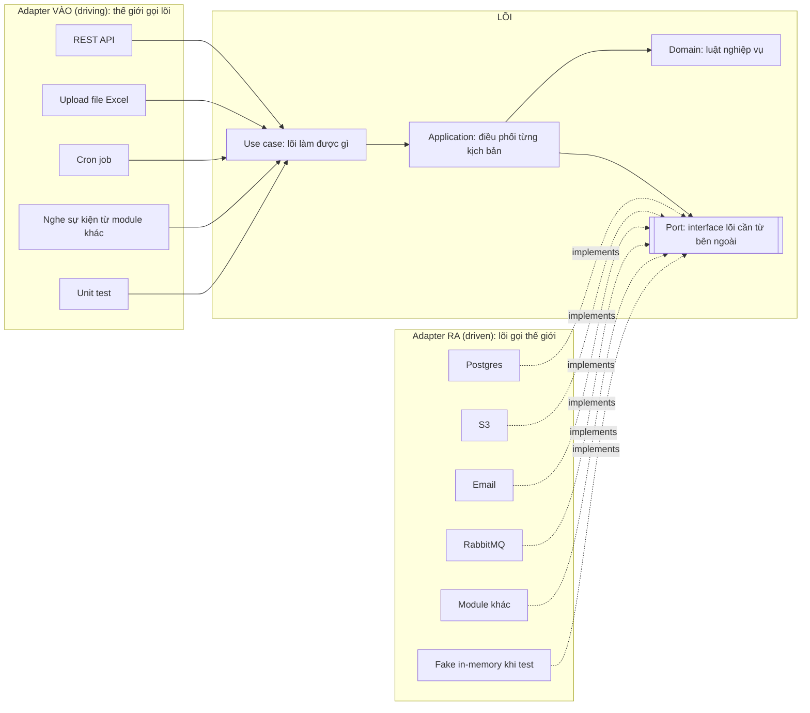
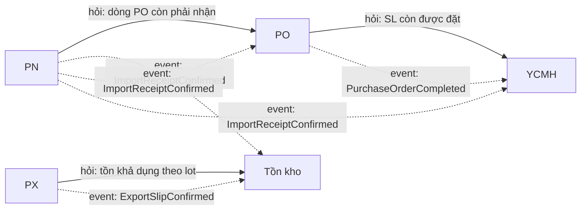
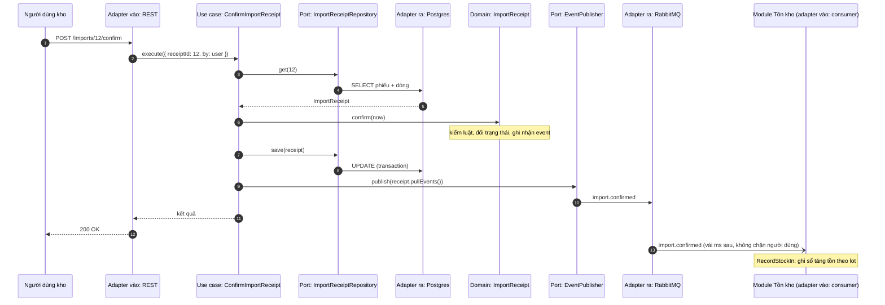
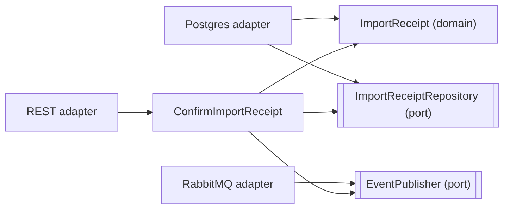

# Capstone · 04 Hexagonal cơ bản (chưa cần NestJS)

> File này chỉ nói **ý tưởng**, không nói framework. Cách làm cụ thể trong NestJS để ở [05-hexagonal-trong-nestjs.md](05-hexagonal-trong-nestjs.md). Ví dụ dùng chuỗi nghiệp vụ thật: **YCMH → PO → PN (phiếu nhập) → PX (phiếu xuất) → Tồn kho**.

## 1. Ý tưởng trong một hình

Hình dung cái laptop. Laptop **tự quy định** cổng USB-C: hình dạng, điện áp, chân nào làm gì. Sạc của hãng nào cũng được, miễn là làm đúng chuẩn cổng đó. Laptop không cần biết sạc do ai làm.

- Laptop là **lõi** (nghiệp vụ).
- Cổng USB-C là **port**: hợp đồng do lõi đặt ra.
- Cục sạc, ổ cứng, màn hình là **adapter**: thứ bên ngoài làm cho khớp với cổng.

Hexagonal (Alistair Cockburn, 2005) áp đúng ý đó vào phần mềm: **nghiệp vụ ở giữa, công nghệ ở rìa, hai bên nói chuyện qua port do nghiệp vụ định nghĩa.** Hình lục giác chỉ để vẽ cho đủ chỗ cắm nhiều thứ, số cạnh không có ý nghĩa.



Mũi tên liền là "gọi". Mũi tên đứt là "cài đặt theo hợp đồng". Để ý: **cả hai phía adapter đều chỉ vào lõi**, lõi không chỉ ra ai cả.

Lợi ích, nói bằng ví dụ thật:

| Muốn | Không có Hexagonal | Có Hexagonal |
|---|---|---|
| Đổi S3 sang Google Cloud Storage | Sửa mọi service có `s3.putObject` | Viết thêm 1 adapter, đổi 1 dòng lắp ráp |
| Test luật "không huỷ được item khi PO đã chốt" | Dựng Postgres, seed bảng PO | Đưa fake trả về "có 1 PO đã chốt", chạy trong vài mili giây |
| Cho phép tạo YCMH từ file Excel, ngoài API | Copy logic từ service API sang | Thêm 1 adapter vào gọi đúng use case cũ |

## 2. Domain: bên trong có những gì

Domain là phần **trả lời câu hỏi nghiệp vụ** mà không cần biết dữ liệu nằm ở đâu hay ai gọi. Thường có các thành phần sau (cái "model, event, error" bạn từng thấy nằm trong danh sách này):

| Thành phần | Là gì | Dấu hiệu nhận ra | Ví dụ trong chuỗi YCMH → Tồn kho |
|---|---|---|---|
| **Entity** | Đối tượng có **danh tính**, sống lâu, trạng thái đổi theo thời gian | Hai cái cùng dữ liệu vẫn là hai cái khác nhau vì khác ID | Phiếu nhập `PN-0012`; đổi số lượng vẫn là phiếu đó |
| **Value Object** | Giá trị **không có danh tính**, so sánh bằng nội dung, bất biến | Đổi nội dung = tạo cái mới | `Quantity(10, "cái")`, `Money(1_200_000, "VND")`, `LotNumber`, mã `YCMH-102026-07` |
| **Aggregate** (+ root) | Một cụm entity + value object **cùng giữ một bộ luật**; bên ngoài chỉ được đụng qua **root** | Luật nói về cả nhóm: "tổng số dòng…", "chỉ khi mọi dòng…" | `PurchaseOrder` (root) + các dòng PO; không ai sửa dòng PO mà không qua PO |
| **Domain Event** | Sự việc **đã xảy ra** mà người khác có thể quan tâm; đặt tên thì quá khứ | "Khi X xong thì bên Y cần biết" | `ImportReceiptConfirmed`, `PurchaseOrderCompleted`, `StockDecreased` |
| **Domain Error** | Vi phạm luật nghiệp vụ, đặt tên bằng ngôn ngữ nghiệp vụ | Người dùng đọc tên lỗi là hiểu | `CannotCancelItemOfConfirmedOrder`, `InsufficientStock`, `LotAlreadyReimported` |
| **Domain Service** | Luật **không thuộc về một entity nào** | Cần nhìn nhiều object cùng lúc | Phân bổ phí ship cho các dòng PO; tính trạng thái phiếu từ trạng thái các item |
| **Policy / Strategy** | Luật **có nhiều biến thể** | `if (nhà máy == ...)` lặp nhiều nơi | Field bắt buộc khác nhau giữa LAB và Bình Minh; FIFO hay FEFO khi chọn lot xuất |
| **Factory** | Cách **tạo** aggregate khi việc tạo phức tạp | Constructor có quá nhiều bước kiểm | Tạo PO từ nhiều YCMH đã duyệt |
| **Repository (interface)** | Hợp đồng "lấy / lưu aggregate", nói bằng từ vựng nghiệp vụ | `get(id)`, `save(order)`, không có SQL | `PurchaseOrderRepository` |

**"Model" có hai nghĩa, đừng nhầm.**

- **Domain model** là entity, value object và aggregate ở trên. Chúng có method mang luật, ví dụ `order.confirm()`.
- **Persistence model** là class ánh xạ bảng (TypeORM entity, Mongoose schema). Nó chỉ có field và nằm ở adapter.

Trong ERP hiện tại hai thứ này là một (`PurchasedRequest` chỉ có `@Column`, xem [03](03-hien-trang.md)). Vì vậy luật mới rơi ra service.

**Ví dụ nhỏ (TypeScript thuần, không framework):**

```ts
// Value object: bất biến, tự kiểm luật của chính nó
class Quantity {
  private constructor(readonly value: number, readonly unit: string) {}
  static of(value: number, unit: string): Quantity { /* value >= 0, không thì ném InvalidQuantity */ }
  minus(other: Quantity): Quantity { /* cùng đơn vị; trả Quantity MỚI */ }
}

// Domain event: một sự việc đã xảy ra
class ImportReceiptConfirmed {
  constructor(readonly receiptId: string, readonly lines: { materialId: number; qty: Quantity }[], readonly at: Date) {}
}

// Domain error: vi phạm luật, tên theo nghiệp vụ
class ReceiptAlreadyConfirmed extends Error {}

// Aggregate root: giữ luật, ghi nhận event, KHÔNG lưu DB, KHÔNG gửi Rabbit
class ImportReceipt {
  private events: object[] = [];
  confirm(now: Date): void {
    // nếu đã CONFIRMED → ném ReceiptAlreadyConfirmed
    // đổi trạng thái → this.events.push(new ImportReceiptConfirmed(...))
  }
  pullEvents(): object[] { /* trả và xoá danh sách event */ }
}
```

Aggregate chỉ **ghi nhận** event, còn ai gửi event đi là việc của application. Domain cũng không gọi `new Date()` mà nhận `now` từ ngoài, để test được.

**Domain KHÔNG chứa:** SQL, tên bảng, HTTP status, JSON của API, chuỗi i18n, cột file Excel, gọi mạng, đọc config, framework DI.

## 3. Application: use case và port

### 3.1 Use case làm gì

Use case (application service) là **kịch bản của một ý định**: "xác nhận phiếu nhập", "huỷ một dòng YCMH". Nó gần như luôn theo cùng một nhịp:

1. Nhận **command** (dữ liệu vào, đã ở dạng nghiệp vụ, không phải request HTTP).
2. **Lấy** aggregate qua port (repository).
3. **Bảo** aggregate làm việc (`receipt.confirm(now)`). Luật nằm ở đây, trong domain.
4. **Lưu** lại qua port.
5. **Phát** event / gọi bên ngoài qua port.
6. Trả **kết quả** (cũng ở dạng nghiệp vụ).

Use case **không** chứa `if` nghiệp vụ. Nếu thấy `if (status === 'CONFIRMED') throw...` trong use case, luật đó đang nằm sai chỗ và nên chuyển vào aggregate (Tell, Don't Ask ở D2).

### 3.2 Port, Adapter, và khi nào bỏ qua Port

**Port là interface, Adapter là class cài đặt interface đó.** Đúng vậy:

- **Port** là interface do lõi viết, bằng từ vựng nghiệp vụ.
- **Adapter** là class `implements` port bằng một công nghệ cụ thể. Một port có thể có nhiều adapter: một cái cho chạy thật, một cái cho test.

```ts
// Port: lõi đặt ra, không nhắc tên công nghệ
interface DocumentStorage {
  publishRequestDocument(requestId: number, file: GeneratedFile): Promise<string>;
}

// Adapter chạy thật
class S3DocumentStorage implements DocumentStorage { /* gọi S3 SDK */ }

// Adapter cho test
class InMemoryDocumentStorage implements DocumentStorage { /* lưu vào một Map */ }

// Use case chỉ biết port
class PublishRequestDocument {
  constructor(private readonly storage: DocumentStorage) {}
}
```

Chú thích nhỏ: controller, cron, consumer cũng được gọi là "adapter" vì chúng đứng ở rìa và dịch thế giới ngoài vào lõi. Nhưng chúng **không implement** gì cả, chỉ **gọi** use case (mục 4).

**Nghiệp vụ nhỏ không cần Port thì dùng thẳng Adapter được không?** Được. Use case hoặc service nhận thẳng class cụ thể, không có interface:

```ts
class RenameMaterialGroup {
  constructor(private readonly groups: TypeOrmMaterialGroupRepository) {} // class cụ thể, không có port
}
```

- **Được:** ít file hơn, đọc một mạch là hiểu.
- **Mất:** muốn test thì phải dựng DB hoặc mock cả class; lõi biết tên công nghệ.

Có một điều nên giữ kể cả khi bỏ port: **gom công nghệ vào đúng một class**. Mọi câu SQL của việc đó nằm trong `TypeOrmMaterialGroupRepository`, không rải trong service. Đến khi cần port, việc thêm chỉ là: tạo interface từ chữ ký các method đang có, thêm `implements`, đổi kiểu tham số constructor. Vài phút là xong, không phải refactor lớn.

| Tình huống | Có cần port? | Vì sao |
|---|---|---|
| CRUD danh mục một bảng, không có luật (đơn vị tính, nhóm NVL) | Không. Thường cũng không cần use case: controller → service → repository | Không có luật nào để bảo vệ hay test riêng |
| Đọc để hiển thị, xuất Excel (query) | Thường không | Đọc thẳng SQL là đủ |
| Lưu aggregate có luật (YCMH, PO, PN, PX) | Có | Muốn test luật mà không cần DB |
| Gọi dịch vụ ngoài: S3, email, API nhà cung cấp | Có | Chậm, tốn tiền, không chạy được trong unit test, hay đổi nhà cung cấp |
| Gọi sang module khác (PN hỏi PO) | Có | Team khác, nhịp thay đổi khác; port là chỗ dịch sang từ vựng của mình |
| Thư viện ổn định (`BigNumber`, `lodash`, xử lý ngày) | Không | Không phải adapter, không có biến thể |

**Dấu hiệu nên thêm port** cho chỗ đang dùng thẳng class:

- Viết test cho một luật đơn giản mà phải dựng DB hoặc mock lằng nhằng.
- Xuất hiện implementation thứ hai.
- Chỗ đó bắt đầu gọi sang hệ thống hoặc module khác.

### 3.3 Command và Query

Tách **ghi** (command) với **đọc** (query) theo ý CQS:

- **Command** đổi trạng thái, đi qua aggregate để giữ luật. Ví dụ: tạo PN, xác nhận PN, huỷ PX.
- **Query** chỉ đọc để hiển thị, **được phép** đọc thẳng SQL / view, join nhiều bảng, không cần dựng aggregate. Ví dụ: danh sách PN, chi tiết PO kèm SL đã nhập, xuất Excel.

Nhờ vậy màn hình danh sách nặng join không làm aggregate phình ra.

## 4. Adapter: vào và ra

| Adapter gọi vào lõi (không implement gì) | Việc của nó |
|---|---|
| REST controller | HTTP request → command → gọi use case → kết quả → HTTP response, đổi domain error → mã lỗi HTTP |
| Upload / import file | Đọc file → nhiều command → gọi **cùng** use case với API |
| Cron job | Đến giờ → gọi use case (vd đối soát chi phí PO thiếu) |
| Consumer sự kiện | Message từ module khác → command → gọi use case (vd PN xác nhận → tồn kho tăng) |
| Unit test | Gọi use case trực tiếp với fake port |

| Adapter cài đặt port (`implements`) | Cài đặt port nào |
|---|---|
| Postgres / TypeORM repository | `ImportReceiptRepository` |
| SQL read model | Query danh sách, chi tiết |
| S3 / GCS | `DocumentStorage` |
| Excel / CSV writer | `SpreadsheetExporter` |
| Email / Telegram | `ApprovalNotifier` |
| RabbitMQ publisher | `EventPublisher` |
| HTTP client nhà cung cấp (SanMar, SSA) | `SupplierCatalog` |
| Gateway sang module khác | `PurchaseOrderGateway`, `StockLedgerGateway` |

Adapter **chỉ dịch**: dịch từ thế giới ngoài vào ngôn ngữ của lõi và ngược lại. Adapter không quyết định nghiệp vụ.

## 5. Use case ứng với API hay ứng với flow?

**Ứng với một ý định nghiệp vụ** (một việc người dùng muốn làm), không phải với một bảng hay một endpoint.

| Quy tắc | Ví dụ |
|---|---|
| Một endpoint ghi thường = một use case | `POST /imports/:id/confirm` → `ConfirmImportReceipt` |
| Một use case có thể được **nhiều adapter** gọi | `CreatePurchaseRequest` được gọi từ API, từ module order-plan, từ module nvl-alert |
| Một endpoint "sửa chung chung" thường đang giấu **nhiều** ý định, nên tách | `PUT /orders/:id/status` với status = confirmed / cancelled / completed → `ConfirmOrder`, `CancelOrder`, `CompleteOrder` (mỗi cái luật khác) |
| Các endpoint đọc gom vào một **query service** | List, detail, export của PN → `ImportReceiptQueries` |
| Flow dài nhiều bước qua nhiều module **không** là một use case khổng lồ | YCMH → PO → PN → PX là **chuỗi** use case nối bằng event, mỗi module một đoạn (mục 6) |
| CRUD danh mục đơn giản (đơn vị tính, nhóm NVL) | Không cần hexagon. Controller → repository là đủ (YAGNI). Hexagon dành cho nơi có luật |

Ví dụ module **Phiếu nhập (PN)**:

| Ý định | Loại | Tên |
|---|---|---|
| Tạo PN nháp (từ PO hoặc tay) | command | `DraftImportReceipt` |
| Sửa dòng PN nháp | command | `ReviseImportReceipt` |
| Xác nhận PN (cộng tồn, phát event) | command | `ConfirmImportReceipt` |
| Tái nhập từ phiếu xuất | command | `ReimportFromExport` |
| Huỷ / khôi phục PN | command | `CancelImportReceipt`, `RestoreImportReceipt` |
| Nhập PN từ file | command | `ImportReceiptsFromSheet` (bên trong gọi lại `DraftImportReceipt`) |
| Danh sách, chi tiết, xuất Excel | query | `ImportReceiptQueries`, `ExportImportReceiptSheet` |

## 6. Nhiều module trong cùng hệ thống: YCMH → PO → PN → PX → Tồn kho

### 6.1 Mỗi module là một lục giác riêng

Mỗi khâu là một **bounded context**: có team chủ quản riêng, từ vựng riêng, dữ liệu riêng, và **bên trong** có domain / application / adapter riêng.

| Module | Team / actor chính | Aggregate | Dữ liệu **chỉ mình được ghi** | Phát event | Cần từ module khác |
|---|---|---|---|---|---|
| YCMH | Bộ phận yêu cầu, người duyệt | `PurchaseRequest` | phiếu YCMH + dòng | `PurchaseRequestApproved` | Biết dòng nào đã vào PO, đã nhận đủ (nghe event) |
| PO | Mua hàng | `PurchaseOrder` | PO + dòng, phí ship | `PurchaseOrderConfirmed`, `PurchaseOrderCompleted` | SL YCMH còn được đặt (**hỏi** YCMH) |
| PN | Kho | `ImportReceipt` | phiếu nhập + dòng + lot | `ImportReceiptConfirmed` | Dòng PO còn phải nhận (**hỏi** PO) |
| PX | Kho, sản xuất | `ExportSlip` | phiếu xuất + dòng | `ExportSlipConfirmed` | Tồn khả dụng theo lot (**hỏi** Tồn kho) |
| Tồn kho | Kho, kế toán | `StockLedger` (sổ kho theo NVL / lot) | sổ kho, tồn theo ngày | `StockChanged` | Nghe PN, PX để ghi sổ |

### 6.2 Hai cách các module nói chuyện

| Cách | Khi nào | Ví dụ | Trong lục giác |
|---|---|---|---|
| **Gọi đồng bộ** (hỏi và chờ trả lời) | Cần câu trả lời **ngay** để quyết định | PX hỏi "lot L1 còn đủ 50 cái không?" trước khi xác nhận | Bên hỏi: port `StockLedgerGateway` + adapter gọi sang Tồn kho. Bên được hỏi: mở query công khai `StockQueries` |
| **Sự kiện bất đồng bộ** (báo rồi thôi) | Bên kia chỉ cần **biết** chuyện đã xảy ra; chậm vài giây không sao | PN xác nhận → Tồn kho ghi sổ tăng, PO cập nhật SL đã nhận, YCMH tự hoàn thành | Bên phát: port `EventPublisher`. Bên nghe: consumer → use case của mình |



Nét liền là gọi đồng bộ, mũi tên chỉ về **bên bị hỏi**. Nét đứt là event, mũi tên chỉ về **bên nghe**.

**Bốn luật giữ cho các module không dính chùm:**

1. **Không đọc, không ghi bảng của module khác.** Chỉ đi qua cửa công khai (use case / query mà module đó mở ra) hoặc event.
2. **Phụ thuộc đồng bộ một chiều, không vòng.** Khâu sau hỏi khâu trước (PN hỏi PO, PO hỏi YCMH), khâu trước muốn biết khâu sau thì **nghe event**. Có vòng (A gọi B, B gọi A) là dấu hiệu ranh giới sai.
3. **Mỗi bên dịch sang từ vựng của mình** (anti-corruption layer). Adapter `PurchaseOrderGateway` trong PN đổi "dòng PO" của bên PO thành "dòng cần nhận" của PN, nên PN không bị đổi theo mỗi khi PO đổi model.
4. **Event mang đủ thông tin cần thiết và tên thì quá khứ.** `ImportReceiptConfirmed { receiptId, lines[{ materialId, lot, qty, poLineId }] }` là đủ, bên nghe không phải gọi ngược để hỏi thêm.

### 6.3 Đối chiếu ERP hiện tại

| Điểm | Hiện trạng | Đúng / chưa |
|---|---|---|
| Event giữa các khâu | Đã có `ImportConfirmed` (`inventory/services/imports.service.ts:1845`), `ExportConfirmed` (`inventory/services/exports.service.ts:1190`), `PurchasedOrderCompleted` (`purchased-order/purchased-order.service.ts:1120`); YCMH nghe 2 event (`purchased-request/processors/status-updater.processor.ts:27-43`) | **Đúng hướng** |
| Ranh giới module | PN, PX và tồn kho cùng nằm trong module `inventory` | Một module gánh 3 bounded context |
| Đọc / ghi bảng chéo | PO đọc bảng YCMH (`purchased-order.service.ts:283`, `:817`); YCMH ghi bảng PO (xem [03](03-hien-trang.md)) | Vi phạm luật 1 |
| Vòng phụ thuộc | PN inject `PurchasedOrderService` qua `forwardRef` (`imports.service.ts:123-124`); trong file đó không thấy chỗ nào gọi tới | Vi phạm luật 2, và có thể xoá ngay |

### 6.4 CRUD và export template chung cho mọi team

Mỗi module đều có CRUD và xuất Excel. Phần **giống nhau** là kỹ thuật, phần **khác nhau** là nghiệp vụ:

| Phần | Đặt ở đâu | Ví dụ |
|---|---|---|
| Động cơ ghi Excel/CSV, phân trang, upload file, audit, auth | **Shared kernel kỹ thuật** (dùng chung, không chứa luật) | `FileWriterFactory`, `AuditInterceptor`, `S3Service` đang có trong ERP |
| Cột nào, tiêu đề gì, dữ liệu lấy từ đâu | Adapter export **của từng module** | `ExcelRequestSheets` của YCMH; PN có `ExcelImportReceiptSheets` riêng |
| Luật nghiệp vụ | Domain **của từng module**, không bao giờ ở shared | Luật tái nhập theo lot chỉ ở PN |

```text
modules/
├── purchase-request/      domain/ application/ adapters/   public-api
├── purchase-order/        domain/ application/ adapters/   public-api
├── import-receipt/        domain/ application/ adapters/   public-api
├── export-slip/           domain/ application/ adapters/   public-api
└── stock-ledger/          domain/ application/ adapters/   public-api
shared/                    # kỹ thuật dùng chung: file writer, storage, auth, audit, event bus
```

## 7. Một API thông thường: flow chạy và flow phụ thuộc

Ví dụ `POST /imports/12/confirm`: kho xác nhận phiếu nhập.

### 7.1 Flow chạy (lúc runtime, ai gọi ai, theo thời gian)



### 7.2 Flow phụ thuộc (lúc viết code, file nào import file nào)



So hai hình. Lúc chạy, use case **gọi tới** Postgres (qua port). Lúc viết code, use case **không import** Postgres; ngược lại, Postgres adapter import port. Chỉ ở hai mũi tên `DB → REPO` và `MQ → PUB`, chiều import ngược với chiều gọi. Đó là toàn bộ "đảo ngược phụ thuộc".

### 7.3 Với API CRUD + export

`GET /imports/export?from=...` là luồng **query**, nên ngắn hơn: adapter REST → `ExportImportReceiptSheet` → port `ImportReceiptReadModel` (adapter SQL đọc thẳng, join thoải mái) → port `SpreadsheetExporter` (adapter dùng `FileWriterFactory` chung) → trả file. Luồng này không dựng aggregate và không phát event.

## 8. DIP chỉ áp cho một số mũi tên

**Đúng.** Chỉ đảo mũi tên đi **từ chính sách (nghiệp vụ) ra chi tiết dễ thay đổi**. Mũi tên vốn đã chỉ vào trong thì giữ nguyên.

| Mũi tên | Hướng tự nhiên | Cần DIP? | Vì sao |
|---|---|---|---|
| REST adapter → use case | Vào trong | Không | Đã đúng chiều, gọi thẳng class use case |
| Consumer → use case | Vào trong | Không | Như trên |
| Use case → aggregate, value object | Vào trong | Không | Cùng lõi, gọi thẳng class |
| Entity → value object | Trong lõi | Không | Cùng lõi |
| Use case → DB, S3, email, Rabbit | **Ra ngoài** | **Có** | Hạ tầng hay đổi, khó test; lõi định nghĩa port, adapter cài đặt |
| Use case → module khác | **Ra ngoài** | **Có** | Module khác có team và nhịp thay đổi riêng; port + adapter (dịch từ vựng) |
| Domain → thư viện ổn định (`BigNumber`, `lodash`, `Date`) | Ra ngoài | Không | Không có biến thể, hiếm khi đổi. Bọc nó là trừu tượng hoá thừa (D5 "rủi ro lạm dụng") |
| Adapter → port | Vào trong | Đây chính là **kết quả** của DIP | |
| Nơi lắp ráp → mọi thứ | — | Không áp dụng | Lắp ráp được phép biết mọi thứ |

**Một câu để tự hỏi trước khi tạo port:** *"Mình có cần thay cái này bằng thứ khác, hoặc bằng fake khi test, không?"* Có thì đảo. Không thì gọi thẳng.

Trong bộ khung capstone có **14 port** cho những thứ lõi gọi ra: lưu phiếu, cấp mã, transaction, đọc hiển thị, PO (3 role), kho (2), Excel (3), S3, email. Thêm **1 interface** `PurchaseRequestCreator` để module khác gọi vào tạo phiếu. Consumer Rabbit chỉ gọi vào use case nên không cần port. Mọi mũi tên khác đi thẳng.

## 9. Tự kiểm tra

1. `Quantity` và `ImportReceipt`, cái nào là entity, cái nào là value object? Vì sao?
2. Luật "không xác nhận PX khi tồn lot không đủ" nằm ở PX hay Tồn kho? PX lấy số tồn bằng cách nào?
3. Use case `ConfirmImportReceipt` có `if (receipt.status === 'CONFIRMED') throw ...`. Sai ở đâu, chuyển đi đâu?
4. Màn hình "Nhóm NVL" chỉ thêm / sửa tên / xoá một bảng. Có cần port không? Khi nào thì nên thêm?
5. PN muốn PO cập nhật "SL đã nhận". Gọi thẳng `PurchaseOrderService.updateReceived()` hay phát event? Vì sao?

<details>
<summary>Đáp án gợi ý</summary>

1. `ImportReceipt` là entity vì có danh tính (`PN-0012`) và sống qua nhiều trạng thái. `Quantity` là value object: hai `Quantity(10, "cái")` là một, không có ID, đổi giá trị thì tạo cái mới.
2. Số tồn thuộc **Tồn kho** (nguồn sự thật). Luật "không xuất quá tồn" được kiểm ở PX, dựa trên số liệu hỏi đồng bộ từ Tồn kho qua port `StockLedgerGateway`. Tồn kho vẫn tự kiểm lại khi ghi sổ, vì nó mới là chủ dữ liệu.
3. Luật trạng thái lọt ra use case (Ask thay vì Tell). Chuyển vào `ImportReceipt.confirm()`; use case chỉ gọi `receipt.confirm(now)`.
4. Không cần. Controller → service → repository dùng thẳng class là đủ, miễn là SQL gom trong một class repository. Nên thêm port khi nhóm NVL bắt đầu có luật cần test riêng (vd "không xoá nhóm đang có NVL"), khi có implementation thứ hai, hoặc khi phải gọi sang module khác.
5. Phát event `ImportReceiptConfirmed` cho PO nghe. PN là khâu sau, gọi ngược PO để **ra lệnh** sẽ tạo vòng phụ thuộc (đúng cái `forwardRef` đang có), và PN không cần chờ PO trả lời mới xong việc.

</details>

---

← [03 Hiện trạng](03-hien-trang.md) · [Mục lục](README.md) · [05 Hexagonal trong NestJS](05-hexagonal-trong-nestjs.md) →
