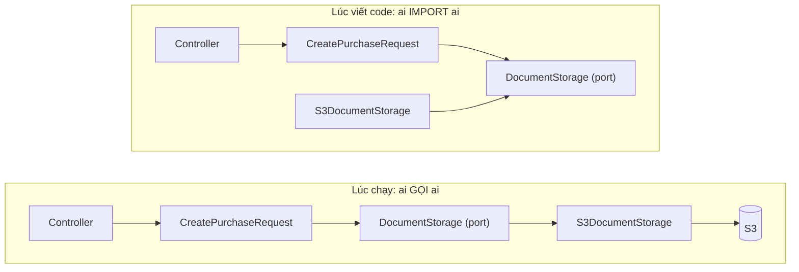
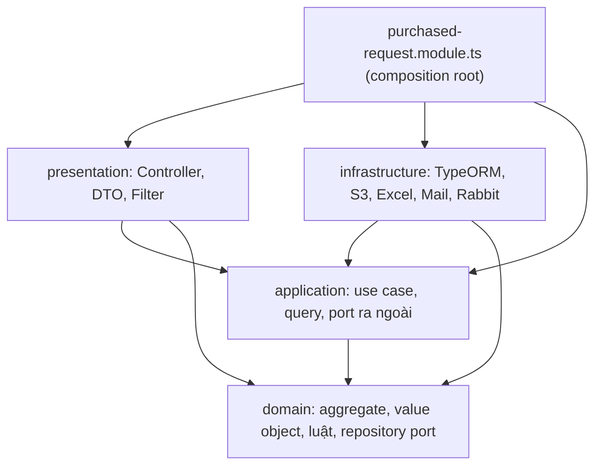

# Capstone · 05 Hexagonal trong NestJS

> Đọc sau [04-hexagonal-co-ban.md](04-hexagonal-co-ban.md) (khái niệm) và trước [06-thiet-ke-lai.md](06-thiet-ke-lai.md). Tên file trong các bảng là file của thiết kế đích ở 06.

## 1. Hexagonal là gì

**Hexagonal Architecture** (Alistair Cockburn, 2005), còn gọi **Ports & Adapters**:

- **Lõi** ở giữa chứa nghiệp vụ: luật YCMH, quy trình duyệt, huỷ item. Lõi không biết HTTP, Postgres, S3, email hay RabbitMQ tồn tại.
- **Port** là interface do **lõi tự định nghĩa**, viết bằng từ vựng nghiệp vụ. Ví dụ `DocumentStorage.publishRequestDocument(requestId, file)`, không phải `putObject(bucket, key, ACL)`.
- **Adapter** là class đứng ngoài, nối một công nghệ cụ thể vào port. Ví dụ `S3DocumentStorage implements DocumentStorage`.

Có hai loại adapter:

| Loại | Ai gọi ai | Ví dụ trong khung | Có cần port không |
|---|---|---|---|
| **Driving** (phía vào, primary) | Thế giới ngoài gọi **vào** lõi | Controller HTTP, consumer RabbitMQ, cron | Không bắt buộc: adapter gọi thẳng use case. Lõi không phụ thuộc vào nó nên không cần đảo |
| **Driven** (phía ra, secondary) | Lõi gọi **ra** thế giới ngoài | Repository TypeORM, S3, email, gọi module PO | **Có**: lõi gọi qua interface, adapter implements. Đây là chỗ DIP đảo mũi tên |

**Dependency Rule** (Clean Architecture): mũi tên `import` chỉ được đi **vào trong**. Vòng ngoài biết vòng trong; vòng trong không biết vòng ngoài.

Nối với D5:

| D5 | Trong Hexagonal |
|---|---|
| **DIP**: ai sở hữu interface? | Lõi sở hữu port; adapter phụ thuộc port, không ngược lại |
| **DI**: ai gọi constructor? | NestJS container tạo adapter và truyền vào constructor của use case |
| **IoC**: ai nắm luồng? | NestJS nhận request rồi gọi controller của bạn; RabbitMQ module gọi `process()` |
| **ISP**: client dùng method nào? | Port tách theo use case dùng nó (3 role cho PO, 2 role cho Excel) |

### Lúc chạy vs lúc viết code: chỗ DIP đảo mũi tên



Lúc chạy, luồng gọi đi từ ngoài vào trong rồi lại ra ngoài (tới S3). Trong mã nguồn, `S3DocumentStorage` import port chứ use case không import S3. Đó là "đảo phụ thuộc".

## 2. Ánh xạ khái niệm sang NestJS

| Hexagonal | Trong NestJS | File trong khung |
|---|---|---|
| Lõi domain | Class TypeScript thuần, **không decorator** | `domain/purchase-request.ts` |
| Use case | Class `@Injectable()`, mỗi class một luồng | `application/use-cases/cancel-request-item.ts` |
| Port | `interface` + **token** `Symbol(...)` đặt cạnh nhau | `application/ports/request-documents.ts` |
| Driven adapter | Class `@Injectable() implements Port` | `infrastructure/storage/s3-document-storage.ts` |
| Driving adapter | `@Controller`, `@Processor` (Rabbit), `@Cron` | `presentation/purchased-request.controller.ts`, `infrastructure/messaging/fulfilment-events.consumer.ts` |
| Nối port → adapter | Provider `{ provide: TOKEN, useClass / useExisting / useFactory }` | `purchased-request.module.ts` |
| Tiêm vào | `@Inject(TOKEN)` trong constructor | mọi use case |
| Đổi lỗi nghiệp vụ sang HTTP | `ExceptionFilter` + `@UseFilters` | `presentation/domain-error.filter.ts` |
| Cửa cho module khác | Chỉ `exports` token của port công khai | `application/public-api.ts` |

**Vì sao cần token?** `interface` của TypeScript bị xoá khi biên dịch, lúc chạy không còn gì để NestJS tra cứu. Nên phải có một giá trị thật (`Symbol`) làm khoá, và `@Inject(TOKEN)` nói "đưa tôi thứ gắn với khoá này".

**Vì sao token đặt cạnh port, không đặt ở infrastructure?** Ai sở hữu hợp đồng thì sở hữu khoá. Nếu token nằm trong infrastructure thì use case phải import infrastructure để lấy token: mũi tên lại chỉ ra ngoài (dấu hiệu vi phạm DIP ở D5).

**Ba cách nối trong module:**

| Cách | Dùng khi | Ví dụ |
|---|---|---|
| `useClass` | Một port, một adapter | `PURCHASE_REQUEST_REPOSITORY → TypeOrmPurchaseRequestRepository` |
| `useExisting` | Một class thoả nhiều port, muốn **một** instance | 3 token PO cùng trỏ `PurchaseOrderModuleLinks` |
| `useFactory` | Chọn implementation lúc khởi động theo cấu hình | `REQUIRED_FIELDS_POLICY` theo `AppName` (`provider`) |

**Đánh đổi có chủ ý:** application vẫn dùng `@Injectable` / `@Inject` của `@nestjs/common`, tức là biết framework DI. Cách thuần hơn là bỏ decorator và đăng ký use case bằng `useFactory` trong module, nhưng sẽ dài hơn và lạ với team. Khung chọn cách thực dụng. Riêng **domain thì không import gì bên ngoài**; trong dự án thật nên có lint chặn điều đó (vd ESLint `no-restricted-imports` hoặc dependency-cruiser).

## 3. Trách nhiệm từng thư mục

| Thư mục | Chứa gì | Được import | Không được import | Đổi khi nào | Test thế nào |
|---|---|---|---|---|---|
| `domain/` | Aggregate, entity, value object, luật (domain service), lỗi nghiệp vụ, port lưu trữ aggregate | Chỉ `domain/` | NestJS, TypeORM, S3, i18n, DTO, `application/` | Luật nghiệp vụ đổi (người duyệt, bộ phận yêu cầu, nhà máy) | Unit test thuần, không mock gì |
| `application/` | Use case (một luồng), query, port ra ngoài, API công khai | `domain/`, `@nestjs/common` | `infrastructure/`, `presentation/`, TypeORM | Quy trình đổi (thêm bước, đổi thứ tự, thêm lệnh) | Unit test với fake port (object in-memory) |
| `infrastructure/` | Adapter: TypeORM, SQL đọc, S3, Excel, email, consumer Rabbit, gọi module khác; mapper bảng ⇄ aggregate | Mọi lớp trừ `presentation/`, mọi thư viện | `presentation/` | Công nghệ đổi (S3 → GCS, đổi schema, đổi thư viện Excel) | Integration test với DB / S3 thật hoặc container |
| `presentation/` | Controller, DTO HTTP, đổi DTO → lệnh, exception filter | `application/`, `domain/` (kiểu, lỗi) | `infrastructure/` | Hợp đồng API đổi (route, JSON, mã lỗi) | Test controller / e2e |
| `*.module.ts` | Composition root: nối token với adapter | Tất cả | — | Đổi cách lắp | Boot test (module khởi động được) |

**Sơ đồ phụ thuộc giữa các lớp** (mũi tên = được phép import):



Không có mũi tên nào đi từ `domain` ra, cũng không có mũi tên giữa `presentation` và `infrastructure`. Trong dự án thật, dùng lint (ESLint `no-restricted-imports`, dependency-cruiser) để máy kiểm tra thay mắt người.

## 4. Luồng một request đi qua NestJS

### 4.1 Vòng đời request trong ERP (code thật)

NestJS chạy theo thứ tự cố định: **Middleware → Guard → Interceptor (trước) → Pipe → Handler → Interceptor (sau) → Exception filter (nếu lỗi)**. Đây là những gì ERP đăng ký ở mỗi tầng (đường dẫn tính từ `erp/backend/src/`):

| # | Tầng | ERP đăng ký gì | Ở đâu | Làm gì với request YCMH |
|---|---|---|---|---|
| 1 | Express | `compression`, `json` 5mb, `urlencoded` | `main.ts:40-42` | Giải nén, parse body |
| 2 | Global prefix | `/api` | `main.ts:44` | URL thật là `/api/purchased-requests/...` |
| 3 | Middleware | `I18nMiddleware`, `RequestContextMiddleware`, `LoggingMiddleware` | `app.module.ts:413-424` | Chọn ngôn ngữ, mở `HandlerContext` (múi giờ, user), ghi log |
| 4 | Router | Khớp method + path với decorator `@Get/@Put...` | controller | Thứ tự khai báo quan trọng: `with-po`, `export` phải đứng trước `:id` (`C:78`, `C:98` trước `C:104`) |
| 5 | Guard | `AuthGuard` toàn cục (`APP_GUARD`) | `app.module.ts:406-409`, `modules/auth/auth.guards.ts:12` | Xác thực, gắn `req.user`; sai thì dừng ở đây (401) |
| 6 | Interceptor trước | `ClassSerializerInterceptor` (global), `AuditInterceptor` (`APP_INTERCEPTOR`), rồi `@UseInterceptors` của route | `main.ts:84`, `modules/audit/audit.module.ts:13`, `C:110` | Đọc metadata `@Audit`; `AppNameRestrictionInterceptor` chặn nhà máy không phải LAB/Bình Minh; `FileInterceptor` nhận file upload |
| 7 | Pipe | `I18nValidationPipe` (global), `ParseIntPipe`, `@ExcelFile` | `main.ts:52-58`, `C:113-114`, `C:59` | Validate DTO, đổi `:id` thành số, kiểm tra file Excel |
| 8 | **Handler** | Method của controller | `C:116` | Gọi xuống nghiệp vụ |
| 9 | Interceptor sau | Theo thứ tự ngược | như 6 | `ResponseInterceptor` bọc JSON chuẩn, Audit lưu log, serializer bỏ field `@Exclude` |
| 10 | Exception filter | `HttpExceptionFilter` toàn cục (+ `DomainErrorFilter` của route trong thiết kế mới) | `main.ts:61-82` | Đổi lỗi thành JSON lỗi; thiết kế mới: lỗi domain → 400/404/409 |

### 4.2 Ví dụ: huỷ một item YCMH

`PUT /api/purchased-requests/12/items/34/cancel`

**Hiện tại:** `C:111-117` → `PurchasedRequestService.cancelItem` (`S:1205`) → `@Lock` → một transaction TypeORM tự query và ghi cả bảng YCMH lẫn bảng PO (`S:1206-1340`). Đọc một hàm 135 dòng là thấy hết, nhưng cũng phải hiểu hết cùng lúc.

**Thiết kế mới:**

```mermaid
sequenceDiagram
  autonumber
  participant FE as Client
  participant NEST as Middleware + AuthGuard + Interceptor + Pipe
  participant C as PurchasedRequestController
  participant UC as CancelRequestItem
  participant REPO as PurchaseRequestRepository (port)
  participant AGG as PurchaseRequest (aggregate)
  participant LINKS as LockedOrdersLookup / OrderLineRelease (port)
  participant PO as Module PO (API công khai)
  FE->>NEST: PUT /api/purchased-requests/12/items/34/cancel
  NEST->>C: cancel(12, 34) sau khi xác thực, kiểm tra nhà máy, ParseIntPipe
  C->>UC: execute(12, 34)
  Note over UC: @Lock + tx.run(...)
  UC->>REPO: get(12)
  REPO-->>UC: PurchaseRequest
  UC->>AGG: materialOf(34)
  UC->>LINKS: lockedOrdersFor(12, material)
  LINKS->>PO: ordersHoldingMaterial(12, material, locked)
  PO-->>LINKS: danh sách PO đã chốt
  UC->>AGG: cancelItem(34, lockedOrders)
  Note over AGG: kiểm luật, đổi trạng thái item, tính lại trạng thái phiếu
  AGG-->>UC: materialReleased
  UC->>REPO: save(request)
  UC->>LINKS: releaseMaterial(12, material)
  LINKS->>PO: releaseMaterial (PO tự xoá dòng, huỷ PO rỗng, phân bổ phí ship)
  UC-->>C: xong
  C-->>NEST: kết quả
  NEST-->>FE: 200, ResponseInterceptor bọc JSON, Audit lưu log
```

Nếu PO đã chốt, `AGG` ném `ItemLockedByConfirmedOrderError`. Lỗi đi ngược lên, `DomainErrorFilter` đổi thành **409** kèm message đã dịch.

### 4.3 Công thức đọc code trong khung mới

| Bạn muốn biết | Mở đâu | Phím tắt VSCode |
|---|---|---|
| Route này làm gì | Controller: decorator `@Put(...)` → tên use case trong thân hàm | Cmd+Shift+O (tìm symbol trong file) |
| Cái gì chạy trước handler | Decorator trên method và class (`@Audit`, `@UseInterceptors`) + bảng 4.1 | — |
| Luồng nghiệp vụ | Use case: constructor = danh sách thứ nó cần; `execute` = các bước "gọi tới →" | Cmd+click tên use case |
| Port này ai cài đặt | Module: dòng `provide: TOKEN` | Cmd+F12 (Go to Implementations) trên interface |
| Luật cụ thể | Method của aggregate, `StatusTransitions`, `RequiredFieldsPolicy` | Cmd+click |
| Lỗi thành mã HTTP nào | `kind` của lớp lỗi trong `domain/errors.ts` → `DomainErrorFilter` | Cmd+click tên lỗi |
| SQL thật nằm đâu | `infrastructure/persistence/*` | Cmd+P gõ `sql-` |

---

← [04 Hexagonal cơ bản](04-hexagonal-co-ban.md) · [Mục lục](README.md) · [06 Thiết kế lại](06-thiet-ke-lai.md) →
