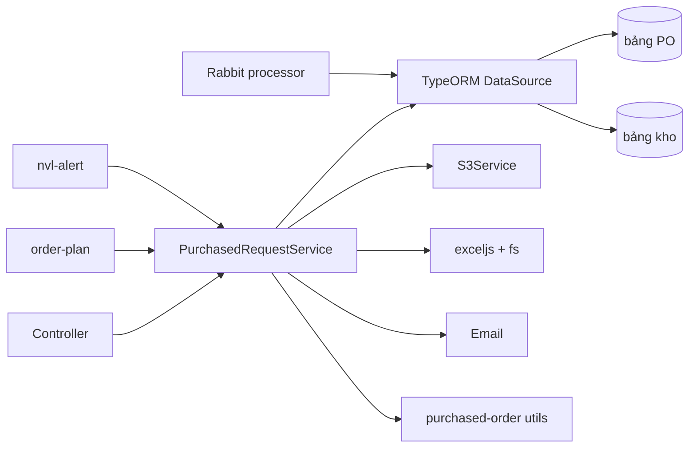
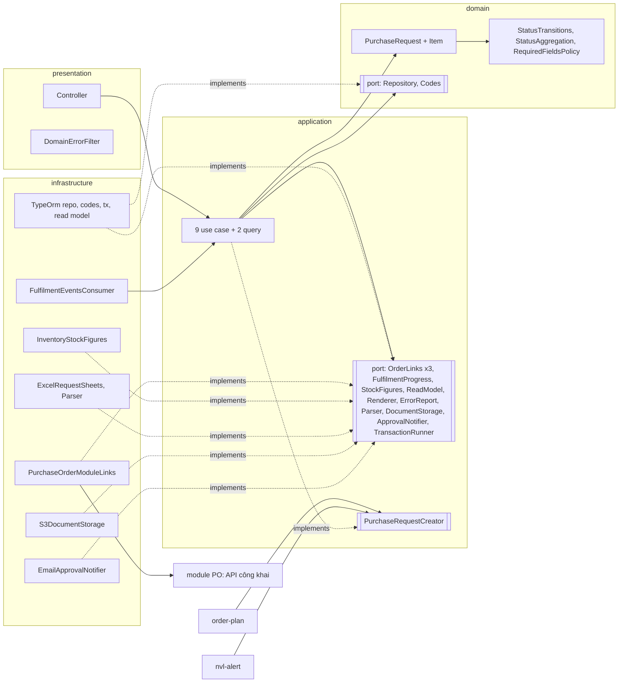

# Capstone · 06 Thiết kế lại purchased-request (Phần 4): chỉ khung

> Hexagonal (Ports & Adapters) kiểu NestJS; khái niệm ở [04-hexagonal-co-ban.md](04-hexagonal-co-ban.md), cách áp vào NestJS ở [05-hexagonal-trong-nestjs.md](05-hexagonal-trong-nestjs.md). Mỗi dòng ở mục 4.2–4.6 là **một file trong thiết kế đích**, kèm trách nhiệm của nó. Hành vi nghiệp vụ giữ nguyên so với hiện tại.
>
> Bộ khung code (49 file `.ts`) đã được viết và kiểm bằng `tsc --strict` cùng một script kiểm Dependency Rule, rồi được xoá sau khi học xong. Phần viết code sẽ làm ở các buổi lab.

### 4.1 Cây thư mục đích

Các mục 4.2–4.6 liệt kê từng file trong cây này.

```text
purchased-request/
├── domain/                                  # không import NestJS, TypeORM, S3, exceljs
│   ├── purchase-request.ts                  # aggregate root
│   ├── purchase-request-item.ts             # entity con trong aggregate
│   ├── purchase-request-code.ts             # value object YCMH-MMYYYY-NN
│   ├── request-status.ts                    # enum + StatusTransitions (thay constants/status-transitions.ts)
│   ├── status-aggregation.ts                # domain service thuần (thay utils/status-aggregator.ts)
│   ├── required-fields-policy.ts            # Strategy theo nhà máy + 3 implementation
│   ├── errors.ts                            # lỗi nghiệp vụ, không phải HttpException
│   └── ports/
│       ├── purchase-request.repository.ts   # port + token
│       └── purchase-request-codes.ts        # port + token
├── application/
│   ├── ports/
│   │   ├── purchase-order-links.ts          # 3 role interface + token (ISP)
│   │   ├── fulfilment-progress.ts
│   │   ├── stock-figures.ts
│   │   ├── purchase-request-read-model.ts
│   │   ├── request-documents.ts             # RequestSheetRenderer, ImportErrorReport, DocumentStorage, RequestSheetParser
│   │   ├── approval-notifier.ts
│   │   └── transaction-runner.ts
│   ├── use-cases/
│   │   ├── create-purchase-request.ts       # cũng là PurchaseRequestCreator cho module khác
│   │   ├── revise-purchase-request.ts
│   │   ├── import-purchase-requests.ts
│   │   ├── delete-draft-purchase-request.ts
│   │   ├── change-purchase-request-status.ts
│   │   ├── send-for-approval.ts
│   │   ├── cancel-request-item.ts
│   │   ├── force-complete-request-item.ts
│   │   ├── complete-fulfilled-items.ts
│   │   └── publish-request-document.ts      # dùng chung bởi 3 use case
│   ├── queries/
│   │   ├── purchase-request-queries.ts
│   │   └── export-purchase-request-sheet.ts
│   ├── errors.ts
│   └── public-api.ts                        # PurchaseRequestCreator + token: thứ DUY NHẤT module export
├── infrastructure/
│   ├── persistence/                         # TypeORM: repo, mapper, mã, transaction, read model, fulfilment SQL
│   ├── purchase-order/                      # adapter gọi API công khai của module PO
│   ├── inventory/                           # adapter số liệu tồn kho
│   ├── excel/                               # renderer + parser
│   ├── storage/                             # S3
│   ├── mail/                                # email-templates
│   ├── messaging/                           # Rabbit consumer (inbound adapter)
│   └── required-fields-policy.provider.ts   # chọn Strategy theo AppName
├── presentation/
│   ├── purchased-request.controller.ts
│   ├── dto/                                 # DTO HTTP + toCommand()
│   └── domain-error.filter.ts               # lỗi nghiệp vụ → HTTP 400/404/409 + i18n
└── purchased-request.module.ts              # composition root
```

### 4.2 Domain

#### Value object và luật trạng thái

- `domain/request-status.ts` — Actor: người duyệt (quy trình duyệt). MỘT nguồn duy nhất cho bảng chuyển trạng thái, dùng cho cả phiếu và item.
- `domain/status-aggregation.ts` — Actor: người duyệt. Domain service thuần: suy trạng thái phiếu từ trạng thái item (6 luật hiện có).
- `domain/purchase-request-code.ts` — Actor: bộ phận yêu cầu (quy ước đánh mã). Value object bất biến.

#### Strategy theo nhà máy

- `domain/required-fields-policy.ts` — Actor: vận hành đa nhà máy. Thay các nhánh if (isLabApp) / if (!isBinhMinhApp) ở S:525-552 và S:1817-1827.

#### Aggregate

- `domain/purchase-request-item.ts` — Entity con, chỉ được sửa qua PurchaseRequest (không có repository riêng).
- `domain/purchase-request.ts` — Actor: bộ phận yêu cầu + người duyệt (cùng sở hữu vòng đời MỘT phiếu). Giữ mọi invariant về trạng thái.

#### Lỗi nghiệp vụ

- `domain/errors.ts` — Lỗi theo ngôn ngữ nghiệp vụ. Việc đổi sang HTTP 400/404/409 và dịch i18n là của presentation (DomainErrorFilter).

#### Port do domain sở hữu

- `domain/ports/purchase-request.repository.ts` — Actor: hạ tầng hiện thực, nhưng hợp đồng viết bằng từ vựng aggregate. Không có EntityManager, QueryBuilder.
- `domain/ports/purchase-request-codes.ts` — Invariant "mã duy nhất" do chính module giữ (sửa vấn đề S:1551 + order-plan phải tự khoá).

### 4.3 Application

#### Port do application sở hữu

- `application/ports/purchase-order-links.ts` — YCMH sở hữu, viết bằng từ vựng YCMH. ISP: 3 role nhỏ vì 2 use case khác nhau dùng 2 tập method khác nhau.
- `application/ports/fulfilment-progress.ts` — Actor: kho. Thay SQL trong processor (P:117-215, P:288-297).
- `application/ports/stock-figures.ts` — Actor: kho. Thay S:920-1021.
- `application/ports/purchase-request-read-model.ts` — Actor: người xem / báo cáo. Phía đọc (CQRS-lite): trả view phẳng, không trả aggregate.
- `application/ports/request-documents.ts` — Actor: báo cáo (định dạng file) + hạ tầng (nơi lưu). Từ vựng: "phát hành", "chia sẻ tạm", không có ACL, bucket, putObject.
- `application/ports/approval-notifier.ts` — Actor: người duyệt (ai nhận, nội dung). Thay ApprovalMailService + sendApprove chết.
- `application/ports/transaction-runner.ts` — Port để use case khai báo ranh giới transaction mà không biết TypeORM.
- `application/errors.ts`

#### API công khai cho module khác

- `application/public-api.ts` — ISP: order-plan và nvl-alert chỉ cần TẠO phiếu. Đây là thứ duy nhất module export (thay exports: [PurchasedRequestService] ở M:30).

#### Use case (mỗi class phục vụ một actor, một luồng)

- `application/use-cases/publish-request-document.ts` — Actor: báo cáo. Dùng chung bởi Create, Revise, SendForApproval (3 nơi → đủ rule of three để tách).
- `application/use-cases/create-purchase-request.ts` — Actor: bộ phận yêu cầu (và module order-plan, nvl-alert)
- `application/use-cases/revise-purchase-request.ts` — Actor: bộ phận yêu cầu
- `application/use-cases/import-purchase-requests.ts` — Actor: bộ phận yêu cầu
- `application/use-cases/delete-draft-purchase-request.ts` — Actor: bộ phận yêu cầu
- `application/use-cases/change-purchase-request-status.ts` — Actor: người duyệt
- `application/use-cases/send-for-approval.ts` — Actor: người duyệt
- `application/use-cases/cancel-request-item.ts` — Actor: mua hàng
- `application/use-cases/force-complete-request-item.ts` — Actor: mua hàng
- `application/use-cases/complete-fulfilled-items.ts` — Actor: kho (sự kiện nhập kho / PO hoàn thành)

#### Query

- `application/queries/purchase-request-queries.ts` — Actor: người xem (mọi vai trò)
- `application/queries/export-purchase-request-sheet.ts` — Actor: báo cáo

### 4.4 Infrastructure (adapter): chỉ tên, implements, dùng gì

- `infrastructure/excel/excel-request-sheet-parser.ts` — Bọc PurchasedRequestFileReader hiện có; được inject thay vì `new` trong service (S:1824).
- `infrastructure/excel/excel-request-sheets.ts` — Actor: báo cáo. MỘT class thoả 2 role (RequestSheetRenderer, ImportErrorReport). Gom cả file lỗi về FileWriterFactory.
- `infrastructure/inventory/inventory-stock-figures.ts` — Actor: kho. Hiện tại là SQL (S:920-1021); sau này đổi sang API module inventory mà use case không biết.
- `infrastructure/mail/email-approval-notifier.ts` — Actor: người duyệt. Thay PurchasedRequestApprovalMailService và sendApprove chết (S:1658).
- `infrastructure/messaging/fulfilment-events.consumer.ts` — Driving adapter (phía VÀO), giống controller nhưng nguồn là RabbitMQ. Chỉ dịch message rồi gọi use case.
- `infrastructure/persistence/purchase-request.mapper.ts` — Actor: hạ tầng. Dịch qua lại giữa entity TypeORM (bảng) và aggregate domain. Domain không biết bảng trông thế nào.
- `infrastructure/persistence/sql-fulfilment-progress.ts` — Actor: kho. SQL hiện có của processor (P:117-215, P:288-297), tách khỏi phần quyết định.
- `infrastructure/persistence/sql-purchase-request-read-model.ts` — Phía đọc: chứa nguyên SQL hiện có, trả view phẳng. Được phép join bảng của module khác vì chỉ ĐỌC để hiển thị.
- `infrastructure/persistence/typeorm-purchase-request-codes.ts` — Hiện thực PurchaseRequestCodes. Khoá theo tháng rồi mới đọc mã cuối: khoá chuyển từ order-plan về đây.
- `infrastructure/persistence/typeorm-purchase-request.repository.ts` — Driven adapter: hiện thực port PurchaseRequestRepository (domain) bằng TypeORM.
- `infrastructure/persistence/typeorm-transaction-runner.ts` — Hiện thực TransactionRunner bằng TypeORM. Giữ EntityManager của transaction trong AsyncLocalStorage
- `infrastructure/purchase-order/purchase-order-module-links.ts` — Driven adapter: MỘT class thoả 3 role interface (ISP). Nói chuyện với module PO qua API công khai của PO,
- `infrastructure/required-fields-policy.provider.ts` — Chọn Strategy theo nhà máy MỘT lần lúc khởi động (OCP: nhà máy mới = 1 class + 1 nhánh ở đây).
- `infrastructure/storage/s3-document-storage.ts` — Driven adapter: chỉ ở đây mới biết bucket key, ACL, Content-Type, presigned URL.

### 4.5 Presentation

- `presentation/domain-error.filter.ts` — Đổi lỗi nghiệp vụ sang HTTP. Chỉ ở đây mới biết mã 400/404/409 và key i18n.
- `presentation/dto/purchase-request.dto.ts` — DTO HTTP: hình dạng JSON client gửi lên. Validate bằng class-validator (lược bỏ decorator trong khung).
- `presentation/dto/to-command.ts` — Dịch DTO HTTP → lệnh nghiệp vụ. Ranh giới: phía trong không thấy DTO.
- `presentation/purchased-request.controller.ts` — Driving adapter HTTP. Giữ nguyên route và interceptor hiện có (C:33-140). Mỗi handler: DTO → lệnh → đúng 1 use case/query.

### 4.6 Composition root

- `purchased-request.module.ts` — Composition root: nơi DUY NHẤT biết port nào nối với adapter nào. Đổi hạ tầng = sửa file này, không sửa use case.

### 4.7 Sơ đồ phụ thuộc: TRƯỚC và SAU

**Trước** (rút gọn từ 3.3):



**Sau:**



**Mũi tên bị đảo:**

| Trước | Sau | Nguyên lý |
|---|---|---|
| Service → `DataSource` (S:68) | `TypeOrmPurchaseRequestRepository` → port `PurchaseRequestRepository` (domain) | DIP |
| Service → `S3Service` (S:70) | `S3DocumentStorage` → port `DocumentStorage` (application) | DIP |
| Service → `exceljs`, `fs` (S:46-48) | `ExcelRequestSheets` → port `RequestSheetRenderer`, `ImportErrorReport` | DIP + ISP |
| Service → bảng PO + util PO (S:53, S:1209-1328) | `PurchaseOrderModuleLinks` → 3 role port; luật PO về module PO | DIP + Encapsulation aggregate |
| Service → bảng kho (S:920-1021) | `InventoryStockFigures` → port `StockFigures` | DIP |
| order-plan, nvl-alert → **cả** service (M:30) | order-plan, nvl-alert → `PurchaseRequestCreator`; use case implements | ISP + DIP |
| Processor → `DataSource` (P:154) | Consumer → use case → port `FulfilmentProgress` | DIP + SRP |
| Luật → `BadRequestException`, i18n (S:12, S:1928) | Luật → lỗi domain; filter → HTTP | DIP |

### 4.8 Bảng ánh xạ: method cũ → nơi mới

| Method cũ | Nơi mới |
|---|---|
| `storage` S:522 (tạo) | `CreatePurchaseRequest.create` + `PurchaseRequest.draft` + `RequiredFieldsPolicy.check` |
| `storage` S:522 (sửa) | `RevisePurchaseRequest.execute` + `PurchaseRequest.revise` |
| `generateCode` S:1551 | `PurchaseRequestCodes.next` (adapter có khoá) + `PurchaseRequestCode.of` |
| `exportToExcelToS3` S:131 | `PublishRequestDocument.forRequest` → `RequestSheetRenderer` + `DocumentStorage.publishRequestDocument` |
| `exportToExcel` S:75, `exportToExcelToFile` S:111, `exportToExcelGetWriter` S:152 | `ExportPurchaseRequestSheet.one` + `ExcelRequestSheets.renderRequest` |
| `exportAllToExcel` S:94, `exportAllToExcelToFile` S:305 | `ExportPurchaseRequestSheet.all` + `ExcelRequestSheets.renderList` |
| `clearExportFile` S:105 | bỏ: renderer trả nội dung trong bộ nhớ, hoặc adapter tự dọn file tạm |
| `find` S:643, `createQueryBuilder` S:659 | `PurchaseRequestQueries.list` → `SqlPurchaseRequestReadModel.list` |
| `findById` S:1023, `getRequestItemQuantities` S:726, `getRelatedPurchaseOrders` S:782 | `PurchaseRequestQueries.detail` → `SqlPurchaseRequestReadModel.detail` |
| `getUnreceivedQuantities` S:920, `getInventoryQuantities` S:995 | `StockFigures.awaitingReceipt`, `StockFigures.onHandToday` |
| `findWithPO` S:1088, `getLatestConfirmedUnitPrices` S:879 | `PurchaseRequestQueries.approvedForOrdering` → read model |
| `delete` S:704 | `DeleteDraftPurchaseRequest` + `PurchaseRequest.assertDeletable` |
| `changeStatus` S:1532 | `ChangePurchaseRequestStatus` + `PurchaseRequest.changeStatus` |
| `autoSyncItemStatusTransition` S:1971 | `PurchaseRequest.cascadeToItems` (private) |
| `validateStatusTransition` S:1921, `validateItemStatusTransition` S:1939 | `StatusTransitions.assertCanMove` (gộp 1) |
| `tryAggregateStatus` S:2044 + processor `completeRequestIfEligible` P:257 | `PurchaseRequest.recomputeStatus` → `StatusAggregation.fromItems` (gộp 1) |
| `sendBulkApprovalEmail` S:1571 | `SendForApproval.execute` |
| `markRequestsAsPending` S:1631 | `PurchaseRequest.submitForApproval` |
| `PurchasedRequestApprovalMailService.send` | `EmailApprovalNotifier.requestApproval` |
| `sendApprove` S:1658 | **xoá** (code chết) |
| `cancelItem` S:1205 (phần YCMH) | `CancelRequestItem` + `PurchaseRequest.cancelItem` |
| `cancelItem` S:1239-1328 (phần PO) | `OrderLineRelease.releaseMaterial` → module PO |
| `recalculatePOItemShippingCosts` S:1414 | **xoá** (code chết; bản đang dùng chuyển hẳn vào module PO) |
| `forceCompleteItem` S:1353, `getInProgressPurchaseOrders` S:851 | `ForceCompleteRequestItem` + `OpenOrdersLookup` + `PurchaseRequest.forceCompleteItem` |
| `createFromFile` S:1816 | `ImportPurchaseRequests` + `RequestSheetParser` |
| `generateErrorExcelAndUpload` S:1723 | `ImportErrorReport.render` + `DocumentStorage.shareTemporarily` |
| Nhánh LAB / Bình Minh S:525-552, S:1817-1827 | `RequiredFieldsPolicy` (3 implementation) |
| `factoryNameMap` S:1668-1676 | `EmailApprovalNotifier` (cấu hình) |
| Processor `process` P:53 và các hàm SQL P:117-215, P:288-297 | `FulfilmentEventsConsumer` → `CompleteFulfilledItems` → `SqlFulfilmentProgress` |
| `shouldCompleteItem` P:242 | `PurchaseRequestItem.isFulfilledBy` |
| ctor `rabbit` S:71, `mailer` S:67 | **xoá** (không dùng) |

### 4.9 Quyết định tách, và chỗ cố ý KHÔNG tách

| Quyết định | Nguyên lý dẫn tới |
|---|---|
| 9 use case theo luồng, gom theo actor | SRP: đổi luật huỷ item (mua hàng) không đụng gửi duyệt (người duyệt) |
| Aggregate `PurchaseRequest` có method, item chỉ sửa qua aggregate | Encapsulation + Tell, Don't Ask: không còn `item.status = ...` ở ngoài |
| `cancelItem(itemId, lockedOrders)` nhận dữ liệu PO làm tham số | Domain giữ luật "không huỷ khi PO đã chốt" mà không phải gọi I/O |
| Luật PO (xoá dòng, huỷ PO rỗng, phân bổ phí ship) trả về module PO | Encapsulation ở mức aggregate: mỗi aggregate tự giữ invariant của nó |
| `StatusTransitions` + `StatusAggregation` là nguồn duy nhất | Một luật một chỗ (bỏ 2 hàm validate trùng và bản "Mirrors") |
| `RequiredFieldsPolicy` Strategy, chọn ở composition root | OCP: nhà máy thứ 5 = thêm 1 class + 1 dòng trong factory |
| 3 role interface cho PO, 2 cho Excel; một class thoả nhiều role qua `useExisting` | ISP: tách theo client, không theo implementation |
| `PurchaseRequestCreator` là thứ duy nhất được export | ISP + DIP: client ngoài phụ thuộc lệnh nghiệp vụ, không phụ thuộc DTO HTTP |
| Mọi port đặt trong domain/application, token đặt cạnh port | DIP: phía nghiệp vụ sở hữu hợp đồng |
| Lỗi domain có `kind`, filter đổi sang HTTP | DIP + hợp đồng (D5): 409 cho "không phải DRAFT", không phải 404 |
| `PurchaseRequestCodes` giữ khoá cấp mã | Encapsulation: invariant "mã duy nhất" do chủ của nó giữ |
| Upload file ngoài transaction | Hợp đồng rõ: phiếu lưu xong mới phát hành file; lỗi file không rollback phiếu |

**Cố ý KHÔNG tách (YAGNI / rule of three):**

| Không làm | Vì sao |
|---|---|
| Port cho thời gian (`moment`), `lodash`, `SafeCalculator` | Không có biến thể, không phải hạ tầng. Đúng mục "rủi ro lạm dụng DIP" của D5 |
| Repository riêng cho item | Item không có vòng đời ngoài phiếu |
| Base class `Repository<T>` chung | Chỉ có 1 aggregate trong module; generic sớm là trừu tượng hoá không bằng chứng |
| Interface cho từng use case | Controller là client duy nhất. Chỉ use case có client ngoài (`CreatePurchaseRequest`) mới có interface |
| Event bus / outbox cho việc gỡ dòng PO | Một consumer, cùng một database: gọi đồng bộ trong cùng transaction là đủ. Chỉ đổi khi PO tách thành service riêng |
| Tách read model theo từng màn hình | 3 query cùng actor, cùng đổi khi đổi màn hình YCMH |
| Strategy cho định dạng file (Excel / CSV / PDF) | Chỉ có Excel. Port `RequestSheetRenderer` tồn tại vì DIP (test, hạ tầng), không phải vì OCP |
| Đổi luật nghiệp vụ (vd cho phép huỷ khi PO Confirmed) | Refactor không đổi hành vi; đổi luật là việc khác, ticket khác |

### 4.10 Kế hoạch chuyển đổi kiểu Strangler Fig

Mỗi bước là một PR độc lập, deploy được, hành vi không đổi, rủi ro thấp trước.

| Bước | Làm gì | Vì sao an toàn | Kiểm tra |
|---|---|---|---|
| **0. Dọn** | Xoá `sendApprove` S:1658, bản private `recalculatePOItemShippingCosts` S:1414, dependency `rabbit`, `mailer` và đoạn comment S:1903-1913 | Chỉ xoá code không ai gọi | Build xanh, spec hiện có xanh, grep không còn tham chiếu |
| **1. Lưới an toàn** | Viết characterization test cho `changeStatus`, `cancelItem`, `forceCompleteItem`, `tryAggregateStatus` và processor (DB test hoặc mock DataSource) | Chưa đổi code sản phẩm | Test chụp đúng hành vi hiện tại, kể cả chỗ lạ (404 khi không phải DRAFT) |
| **2. Gom luật trạng thái** | Tạo `domain/request-status.ts` + `status-aggregation.ts`; service và processor gọi chung, bỏ bản trùng | Hàm thuần, phủ bởi test bước 1 | Test bước 1 xanh; spec aggregator chạy trên file mới |
| **3. Cửa cho module khác** | Thêm `PurchaseRequestCreator` + `CreatePurchaseRequestCommand`; adapter tạm gọi `storage()` cũ; chuyển order-plan, nvl-alert sang token; dời khoá cấp mã vào `PurchaseRequestCodes`; đổi `exports` của module | Branch by abstraction: bên trong vẫn là code cũ | Hết `dto as never`; tạo YCMH từ order-plan và nvl-alert chạy như cũ |
| **4. Đẩy hạ tầng ra rìa** | Tạo `DocumentStorage`, `RequestSheetRenderer`, `ImportErrorReport`, `ApprovalNotifier` + adapter; service cũ gọi qua port | Mỗi adapter bọc đúng code đang chạy | So file Excel xuất ra trước/sau giống nhau; email test gửi được |
| **5. Trả luật về PO** | Module PO thêm API `releaseMaterial`; `cancelItem` gọi qua `OrderLineRelease` trong cùng transaction | Rủi ro cao nhất (tiền: phân bổ phí ship) nên làm sau cùng, có test bước 1 | So phí ship phân bổ trước/sau trên dữ liệu thật đã ẩn danh |

Sau bước 5: chuyển từng endpoint sang use case mới (aggregate + repository) theo thứ tự đọc → ghi đơn giản → ghi phức tạp, mỗi endpoint một PR; khi không còn ai gọi `PurchasedRequestService` thì xoá class đó.

---

← [05 Hexagonal trong NestJS](05-hexagonal-trong-nestjs.md) · [Mục lục](README.md)
